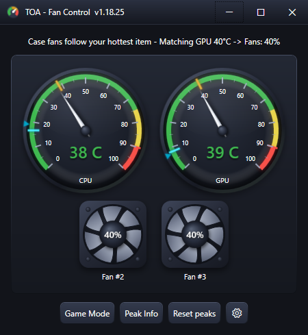
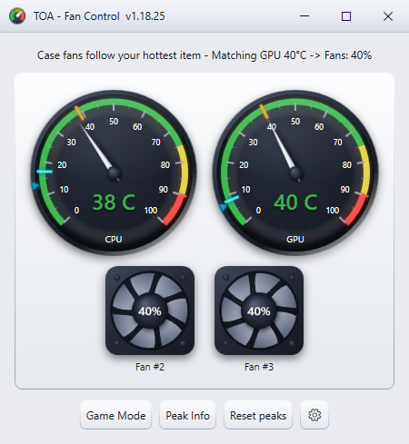
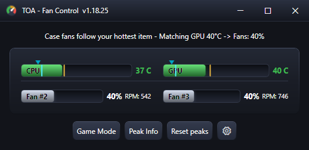
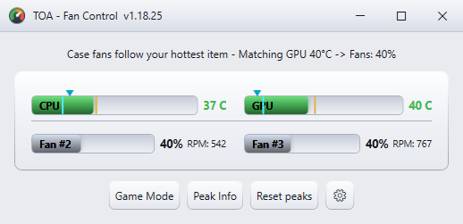
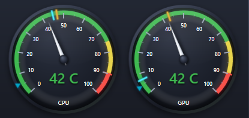
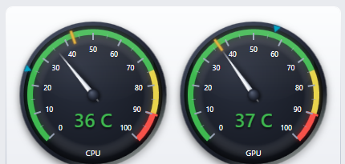
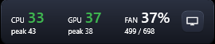
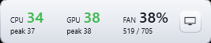
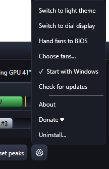

<h1 align="center">TOA - Fan Control</h1>

  <b>Zero-config fan control for Windows 10/11 64 bit PC case fans.</b> 
  <b>Your case fans follow your hottest component, the CPU or the GPU. It's that simple. That's the app.</b>

  
  &nbsp;&nbsp;&nbsp;
  
  &nbsp;&nbsp;&nbsp;
  

---

  
  &nbsp;&nbsp;
  

  
  &nbsp;&nbsp;
  

## Why this exists

Years ago I installed SpeedFan to cool my PC down. After ten minutes of asking myself "What is this? What is that?", I uninstalled it. Its successor, FanControl, is genuinely powerful, but it still comes with curve editors and homework I don't want.

I wanted simplicity: cooler parts, quiet fans, nothing to configure. A "start it and forget it" app. With the help of Claude AI, I built exactly that. Hopefully... it's what you've wanted, too.

## What it does

Your **case fans follow your hottest part, CPU or GPU**, one-to-one: **70°C means 70% fan speed.**

- Fans follow the hottest reading of the last 15 seconds, so bursty loads don't make them surge up and down. Past 70°C they run up to 5% ahead for extra push.
- A **30% floor** means no fan ever stalls, and speed changes glide instead of jerk.
- **AIO pumps, CPU coolers and GPU fans are never touched.** They stay on your BIOS and GPU driver.
- **No bloatware.** One small app. No services, no account, no ads. Its only two requirements, Microsoft's .NET and the PawnIO driver, are official, signed, and installed with your OK.

No curves, no profiles, no tuning. If you want those, [FanControl](https://github.com/Rem0o/FanControl.Releases) is excellent.

## What you get

It sits in the system tray and runs itself. When you want to look:

- **Dashboard:** CPU/GPU dials or bars with peak markers, plus a spinning tile for each case fan. **Peak Info** shows when each peak hit and what app was running.

  
&nbsp;&nbsp;

- **Game Mode:** a small, always-on-top readout you can drag anywhere. Works over borderless and windowed fullscreen games.

  
&nbsp;&nbsp;

- **Settings (the ⚙ cog):** theme, dials or bars, hand fans to BIOS, choose fans, start with Windows, check for updates, donate and uninstall.

  

- **True GPU load:** the cyan marker shows watts pulled versus your card's maximum, from a library of 185+ cards.
- **Keeps itself updated:** the app, PawnIO and .NET, with signature checks. It never pops up mid-game.

## If anything fails, your BIOS takes over

<table align="center">
  <tr><th>What happens</th><th>Result</th></tr>
  <tr><td>You close the app</td><td>Fans back to BIOS control</td></tr>
  <tr><td>The app crashes</td><td>Fans back to BIOS control</td></tr>
  <tr><td>The app is force-killed (Task Manager)</td><td>A watchdog process restores BIOS control</td></tr>
  <tr><td>Temperature readings vanish</td><td>Fans handed to BIOS within 3 seconds</td></tr>
  <tr><td>Windows shuts down or you log off</td><td>Fans back to BIOS control</td></tr>
  <tr><td>You uninstall</td><td>Fans back to BIOS control</td></tr>
</table>

Worst case, your PC behaves exactly as it did before you installed this. Every path is tested on real hardware.

## Installing

Needs Windows 10 or 11, 64-bit. The installer adds .NET 10 and PawnIO if they're missing, with your OK.

1. Download **`TOA - Fan Control Setup.exe`** from [Releases](../../releases). That's the only official download.
2. Run it. Windows shows a blue **"Windows protected your PC"** warning because the app is new and unsigned. Click **More info → Run anyway**. The full source code is right here.
3. Pick where to install it, then choose your case fans on first launch. Done.

Every past version stays on the Releases page if you ever need to roll back.

## FAQ

**Why does it need admin?**
Fan speeds live on a motherboard chip that Windows only lets admin apps reach, through the signed PawnIO driver.

**Which PCs does it work on?**
PCs with a retail motherboard (ASUS, MSI, Gigabyte, ASRock), including most gaming-shop prebuilts. Big-brand desktops (Dell, HP, Lenovo) and laptops lock their fans to their own controller, so there it's a temperature dashboard only.

**Why not just use a BIOS fan curve?**
Most BIOS curves only follow the CPU. They can't see your GPU, so in games your case fans just idle. This app watches both.

**Why doesn't it touch the CPU fan?**
On purpose. Your CPU cooler, AIO pump and GPU fans stay on the BIOS, so nothing this app does can ever starve them.

**What do the dial colors mean?**
Green: full speed. Yellow: still safe, but the chip starts slowing itself down. Red: the chip's emergency brake. Hover a zone in the app for more.

**What's "load" versus "busy time"?**
Busy time is revving in neutral. Load is towing a trailer up a grade. The GPU marker shows true load (watts versus the card's max). The CPU shows busy time, because CPUs have no honest power max to measure against.

**Will it wear out my fans?**
No. Changes are small, electronic and gentle, and the 30% floor prevents stop/start cycling. [Full explanation](Docs/why_it_doesnt_wear_fans.md)

**Does it touch my RGB, or fight SignalRGB / iCUE / Armoury Crate?**
Lighting is never touched. If another app also controls your fans, this app notices within seconds, holds your speeds, and tells you to turn off that app's fan control.

**Is this related to Rem0o's FanControl?**
No. That's the powerful, customizable one. This is the zero-config one.

**Some sensors don't show on my brand-new hardware.**
The sensor library only updates through tested releases. Until support arrives, the app runs read-only and your BIOS keeps the fans. Open an [issue](../../issues) with your hardware details.

## Your data stays yours

Nothing is collected or sent: no telemetry, no accounts. The app only goes online to check for updates and to download the GPU library, and those requests carry nothing about you or your PC.

## Found a bug?

Open an [Issue](../../issues) and attach `fan_debug.log` from the app's folder. It holds no personal info: just temperatures, fan speeds, app events, and hardware model names.

---

**© 2026 TOA. Released under the [GNU GPLv3](LICENSE).** Free forever, and every fork must stay open source too. (Versions up to v1.12.2 were released under MIT.)

This software is provided "as is", without warranty of any kind, express or implied. It controls real hardware (your fans), and while it is designed to always return them to motherboard (BIOS) control and never drive them below a safe floor, you use it at your own risk. TOA is not liable for any damage to hardware, loss of data, or any other damages arising from the use of this software.
